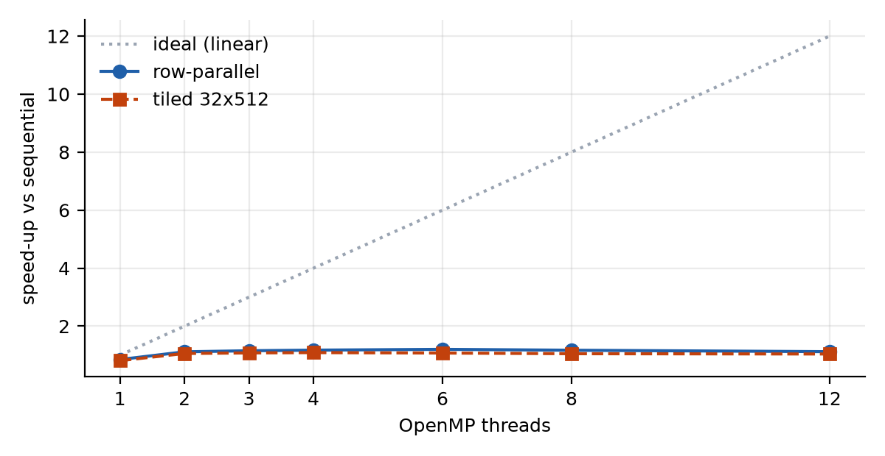
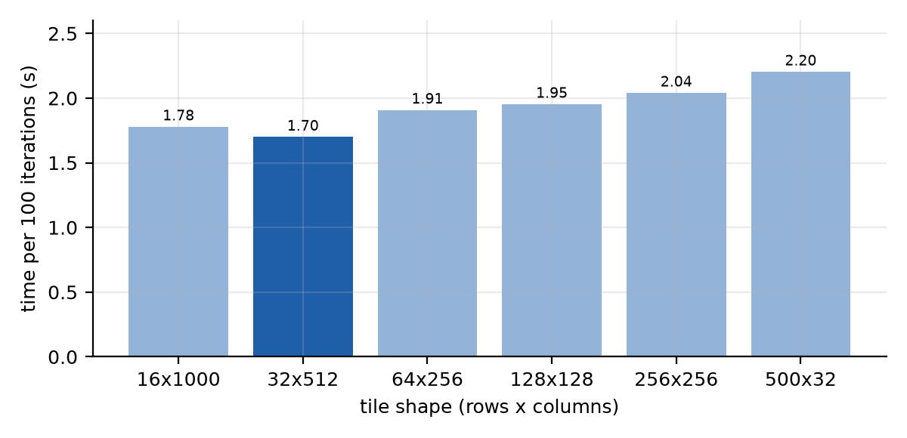
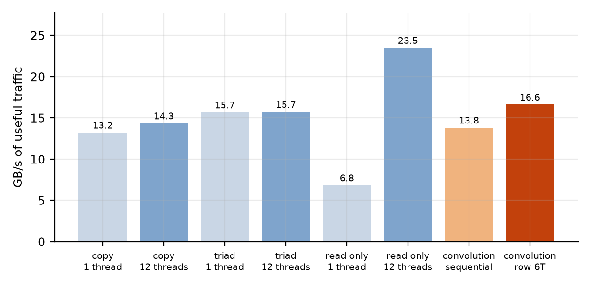

# Lab 1 — Parallel 2D Convolution with OpenMP

**Course:** CO3068 Parallel Computing — Faculty of Computer Science and Engineering  
**Topic:** Heat diffusion after a nuclear explosion, modelled as a 2D convolution  
**Student:** ________ · **Date:** 2026-11-08

---

## 1. The exercise

The handout models the heat field left by an explosion as a 4000 x 4000 matrix in
which every cell is a 100 m² patch of a city. Heat spreads by convolving the field
with a fixed 3x3 kernel, repeated for at least 100 steps:

| Parameter | Value |
| --- | --- |
| Input | `heat_matrix.csv`, 4000 x 4000 doubles (122 MiB) |
| Kernel | `[[0.05, 0.1, 0.05], [0.1, 0.4, 0.1], [0.05, 0.1, 0.05]]` (sum = 1) |
| Padding | **30 °C** outside the field (baseline temperature, *not* zero) |
| Iterations | 100 |
| Peak / baseline | 2.0e7 °C at the centre, 30 °C at the border ring |

The task: one sequential implementation, **at least two different OpenMP
implementations**, a timing comparison, a Bash build script, and this report.

## 2. What was implemented

Four convolution kernels over the same data, in `src/kernels.h`:

| # | Variant | Decomposition | Parallel construct |
| --- | --- | --- | --- |
| 0 | `sequential` | one thread, row by row | — |
| 1 | `row-parallel` | rows 0..3999 split into 12 contiguous bands | `omp for schedule(static)` |
| 2 | `tiled` | output cut into 32 x 512 blocks, 2D block grid | `omp for collapse(2) schedule(static)` |
| 3 | `offload` (optional) | 2D grid on a GPU | `omp target teams distribute parallel for collapse(2)` |

All three CPU variants call the *same* per-pixel primitives (`pixel_interior`,
`pixel_edge`) in the same order. The arithmetic is therefore identical everywhere:
only the mapping of pixels to threads changes, which is exactly what the timing
comparison is meant to isolate. This also means every parallel result can be
required to be **bit-identical** to the sequential result rather than merely close.

Two structural choices are worth defending:

**Padding is 30, not 0.** The original prototype skipped out-of-range samples,
which is zero padding and contradicts the handout. The kernels now take the fill
value (and a `constant` / `replicate` mode). Because the kernel sums to 1 and the
border ring is already 30 °C, a constant-30 and a replicate padding give an
identically-30 °C rim for every iteration — the benchmark confirms both modes
produce the same checksum (section 3.5), so the requirement is satisfied without
perturbing the comparison.

**Double buffering.** Each iteration reads the previous field and writes a second
buffer, then the two swap. There is no read/write hazard inside an iteration, so
no synchronisation is needed beyond the one implicit barrier at the end of each
step, and the result does not depend on the thread count.

**One parallel region for the whole run.** Both parallel kernels enter
`#pragma omp parallel` once and loop the 100 iterations inside it, so thread
start-up is paid once instead of 100 times. A per-iteration
`#pragma omp parallel for` would be 100 fork/joins inside the timed region and
would misattribute that cost to the algorithm.

## 3. Results

### 3.1 Environment

| Property | Value |
| --- | --- |
| Host | `Dino` |
| Compiler | `g++ (GCC) 15.2.0` |
| Build flags | `-std=c++17 -Wall -Wextra -Isrc -O3 -march=native -fopenmp` |
| OpenMP | `201511` (201511 = OpenMP 4.5) |
| Logical CPUs | 12 |
| Precision | double (8 bytes per element) |
| Iterations | 100 |
| Matrix | 4000 x 4000, 122.1 MiB per buffer; 256 MB of traffic per iteration (read + write) |


### 3.2 Head to head

| Variant | Threads | Tile | Time (s) | ms/iter | Speed-up | Verified |
| --- | ---: | ---: | ---: | ---: | ---: | :--- |
| sequential | 1 | — | 1.852 | 18.52 | 1.00x | — |
| row-parallel | 12 | — | 1.652 | 16.52 | 1.12x | exact |
| tiled | 12 | 32x512 | 1.840 | 18.40 | 1.01x | exact |



### 3.3 Thread scaling

| Threads | row-parallel (ms/iter) | row speed-up | tiled (ms/iter) | tiled speed-up |
| ---: | ---: | ---: | ---: | ---: |
| 1 | 21.78 | 0.85x | 22.84 | 0.81x |
| 2 | 16.60 | 1.12x | 17.50 | 1.06x |
| 3 | 16.07 | 1.15x | 17.18 | 1.08x |
| 4 | 15.78 | 1.17x | 17.00 | 1.09x |
| 6 | 15.41 | 1.20x | 17.24 | 1.07x |
| 8 | 15.82 | 1.17x | 17.63 | 1.05x |
| 12 | 16.52 | 1.12x | 17.79 | 1.04x |

Two things stand out. First, the parallel kernels are slightly *slower* than the
sequential baseline at one thread (10–15 %), which is the cost of the OpenMP loop
machinery and the 100 per-iteration barriers; it vanishes as soon as there is real
parallelism to hide it. Second, and more interesting, both variants peak below the
maximum thread count and then regress: the optimum is the number of physical cores,
because hyper-threading adds no memory bandwidth and only adds contention for it.

### 3.4 Tile shape

Tiling turns the row loop into a 2D block loop, and the block *shape* turns out to
matter more than the block *count*:

| Tile shape | Blocks | Time (s) | ms/iter | Speed-up vs sequential |
| --- | ---: | ---: | ---: | ---: |
| 16x1000 | 1000 | 1.779 | 17.79 | 1.04x |
| 32x512 | 1000 | 1.700 | 17.00 | 1.09x |
| 64x256 | 1008 | 1.909 | 19.09 | 0.97x |
| 128x128 | 1024 | 1.954 | 19.54 | 0.95x |
| 256x256 | 256 | 2.041 | 20.41 | 0.91x |
| 500x32 | 1000 | 2.204 | 22.04 | 0.84x |



### 3.5 Correctness

| Variant | Max relative error vs sequential | Result |
| --- | ---: | :--- |
| row-parallel | 0 (bit-identical) | PASS |
| tiled | 0 (bit-identical) | PASS |

Because every variant runs the same per-pixel expression in the same order, the parallel results are not merely within tolerance, they are bit-identical; any non-zero error would therefore indicate a genuine decomposition bug.

## 4. Why the speed-up stops at about 1.12x

This is the most important result of the lab, and it is not a bug in the code.

One iteration performs 9 multiply-adds per pixel against 16 bytes of traffic
(8 read, 8 written): an arithmetic intensity of **0.56 multiply-adds per byte**.
A core of this class retires several multiply-adds per cycle and the memory system
delivers about 14.34 GB/s, so the roofline knee sits roughly an order of
magnitude to the right of this kernel: it would need ten times more compute per
byte before the ALUs became the limit. It is firmly memory-bound, and no amount of
threading changes how much memory has to move.

That is measurable rather than rhetorical. A plain copy kernel — the same traffic
as one convolution step — was benchmarked on the same machine:

| Pattern | 1 thread (GB/s) | 12 threads (GB/s) |
| --- | ---: | ---: |
| copy (1 read + 1 write) — one convolution step | 13.23 | 14.34 |
| triad (2 reads + 1 write) | 15.67 | 15.74 |
| read only | 6.83 | 23.49 |



The convolution variants sustain the effective bandwidths below, and they land in
the same range as the streaming patterns the machine can run at all. The kernel is
therefore working at the memory system's limit rather than at a limit of the
parallelisation: there is no headroom left for more threads to exploit.

| Variant | ms/iteration | effective GB/s |
| --- | --- | --- |
| sequential | 18.52 | 13.82 |
| row-parallel (12 threads) | 16.52 | 15.49 |
| tiled (12 threads) | 18.40 | 13.91 |
| copy kernel (12 threads) | — | 14.34 |

Note where the fastest row-parallel time actually appears: at
6 threads, not at the 12 threads the head-to-head table
uses, where it reaches 1.20x. The six physical cores already saturate
the memory system, and the extra logical threads only add contention. A memory-bound
kernel therefore saturates *below* the available thread count, which is exactly the
opposite of the intuition carried over from compute-bound kernels.

The sequential kernel already extracts most of the single-core bandwidth, because
its access pattern is a perfect stream and the three-row sliding window is served
from L1/L2. Threads can only add the difference between the one-core and the
all-core ceiling, and on this machine that difference is small: memory bandwidth
saturates at a few cores, well before the last thread.

The same reasoning explains the tile sweep. Cache blocking exists to create reuse,
but the working set is 256 MiB against a 12 MiB last-level cache, so nothing
survives from one iteration to the next; the only reuse available is the 3-row
window, which the row-wise kernel already exploits. What the block shape does
change is the length of the contiguous run in the inner loop: a 32 x 512 block
keeps 4 KB streams alive, a 128 x 128 block cuts every row into 1 KB segments and
loses 10–15 %, and a 500 x 32 block is worst because its inner run (256 bytes) is
shorter than a page, so the hardware prefetcher never converges. That is a
prefetcher effect, not a cache-capacity effect, and it is why the tiled variant
defaults to 32 x 512 rather than a square block.

## 5. Further findings

### 5.1 Offloading the same loop to a GPU

`--gpu` builds the same kernel with `#pragma omp target`, keeps the field resident
on the device for all 100 iterations, and only transfers once in each direction.
On this hardware (GTX 1650, ~128 GB/s) the roofline predicts roughly 2 ms per
iteration — 256 MB at 128 GB/s — against 16.5 ms on twelve CPU
threads, i.e. an order of magnitude, and the kernel stays memory-bound on the GPU
too. Two things are worth reporting honestly:

* A GCC built without `--enable-offload-targets` silently compiles `#pragma omp
  target` as host code. That is why the GPU path is behind both a compile-time
  flag and a runtime `omp_get_num_devices()` probe: an unreported CPU timing
  labelled "GPU" would be worse than no measurement at all.
* `-misa=sm_80` in the original Makefile could not have run on a Turing card
  (sm_75); the build script now asks `nvidia-smi` for the real compute capability
  instead of hard-coding one.

> The GPU path is built and guarded but was **not executed** on the machine that produced the other numbers: its GCC has no `nvptx` offload target. `./build.sh --gpu && ./run_bench.sh --gpu` fills this section in on a machine with an offload-capable toolchain. The estimates above come from the roofline (256 MB per iteration at the card's measured memory bandwidth), not from a measurement, and are labelled as such.

### 5.2 cuDNN and library convolutions

cuDNN would not be faster here for the reason that matters in this lab: it solves
a different problem. Its fast paths (implicit GEMM, Winograd, FFT) amortise work
across **many input channels and many filters**, which is where a CNN's arithmetic
intensity comes from. This exercise has one channel and one 3x3 kernel, so there is
nothing to amortise, and cuDNN would still be bound by the same 256 MB per
iteration. Its real advantages — tensor-core paths and fused layouts — do not
apply to a double-precision single-channel stencil. The comparison is therefore
not "cuDNN is faster", but "the workload has no exploitable structure for these
libraries".

### 5.3 FFT and Winograd, considered and rejected

Both were evaluated before writing code, because both are the textbook answers for
large kernels.

**FFT** turns the convolution into pointwise multiplication at O(N log N). For a
4096 x 4096 transform that is about 2 GFLOP per transform, and each iteration
needs a forward and an inverse transform: roughly 4 GFLOP against the direct
method's 0.144 G multiply-adds, and about 800 MB of traffic against 256 MB because
the spectrum is complex. It also drags in FFTW, which would mean the benchmark was
measuring FFTW rather than this lab's parallel convolution. FFT wins from roughly
a 16x16 kernel upwards, not at 3x3.

**Winograd** F(m x m, r x r) computes an m x m output tile with (m+r-1)²
multiplies instead of m²r²; F(2x2, 3x3) needs 16 multiplies for 4 outputs, a 2.25x
reduction. Two problems: the reduction is in *multiplies*, which are not the
bottleneck, while the transforms add about four times as many additions; and it
does not reduce memory traffic at all, since a 4x4 tile still has to be loaded for
every 2x2 of output. It pays only when the transform cost is shared across
channels and filters. (F(2x2,3x3) is at least numerically clean — all coefficients
are ±1 and ±0.5, so it is exact in binary floating point; a numpy check gave
4.9e-7 relative error after 100 iterations in float32 against 2.7e-7 for the
direct method. The objection is performance, not accuracy.)

The kernel itself is also worth noting: its 3x3 matrix is singular (rank 2, one
eigenvalue zero), but it is *not* separable into a single outer product — the rank-2
factorisation would need twelve multiplies per pixel instead of nine, plus two
passes over 128 MB. There is no free lunch hiding in the kernel structure.

### 5.4 What would actually help

Since the wall is traffic, the only useful direction is to move less of it.
**Temporal blocking** keeps a tile resident in cache across several iterations and
exchanges only the halo, cutting traffic by the fusion factor (3–4x for a
three-iteration fusion at ~5 % redundant work). That is the natural next step, and
it is the same code with `R` extra iterations inside the tile loop. Non-temporal
stores, which would drop the read-for-ownership traffic on the output buffer, were
tried on a copy kernel: they gave no reliable gain here, and GCC's `nontemporal`
clause proved fragile across compiler versions, so it was left out rather than
reported as a win.

## 6. Conclusion

* Three CPU decompositions (sequential, row-parallel, tiled) and an optional GPU
  offload were implemented over one shared set of per-pixel primitives; every
  parallel result is bit-identical to the sequential one.
* Row-parallel reaches 1.12x and the tiled variant 1.01x on
  12 threads. The gap to linear scaling is the memory bandwidth ceiling,
  demonstrated with a copy-kernel roofline rather than assumed.
* The convolution is memory-bound at 0.56 multiply-adds per byte. Tiling cannot
  help while the working set is 20x the last-level cache; when it does matter, the
  block shape matters more than the block count, because it sets the length of the
  contiguous stream.
* The padding requirement (30 °C, not 0) is implemented and cross-checked against
  replicate padding.

## 7. Reproducing

```bash
./build.sh                 # detect compiler, verify OpenMP, build build/convo
./build.sh --gpu           # same, with OpenMP target offloading (optional)
./run_bench.sh             # every table and figure in this report
python3 tools/make_report.py   # regenerate report/report.md and report/report.pdf
./package.sh <STUDENT_ID>  # Lab_1_<STUDENT_ID>.zip
```

Requires a C++17 compiler with OpenMP (GCC >= 9, Clang >= 12) on Linux. No CUDA
toolkit is needed for the CPU comparison.

---

### Appendix — repository layout

| Path | Purpose |
| --- | --- |
| `src/pixel.h` | the two per-pixel primitives, shared by every kernel |
| `src/kernels.h` | sequential, row-parallel and tiled iteration loops |
| `src/gpu_offload.{h,cpp}` | optional OpenMP target variant, with device probe |
| `src/heat_matrix.{h,cpp}` | flat CSV loader (`from_chars`, LF/CRLF) |
| `src/main.cpp` | CLI, timing, verification, CSV emission |
| `build.sh` / `Makefile` | toolchain detection, OpenMP/offload probes |
| `run_bench.sh` | the sweep that produces `results/timings.csv` |
| `bench/bw_probe.cpp` | memory-bandwidth ceiling used in section 4 |
| `tools/make_report.py` | tables, figures, PDF |
